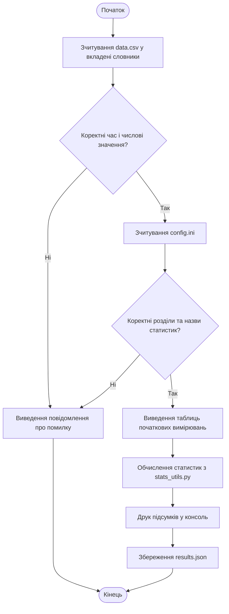

<div align="center">

Міністерство освіти та науки України  
Національний технічний університет  
«Харківський політехнічний інститут»  

<br>

### Програмні засоби систем керування

**Кафедра «Автоматика і управління в технічних системах»**  

Звіт про виконання лабораторної роботи №3 з курсу "Прикладне програмування на Python"  

**Тема: «Робота з файлами користувацьких даних»**

</div>

<br>

<div align="right">

**Виконав:**  
ст. гр. ІКМ-724а  
Костенко Д.М.  

**Перевірив:**  
ст. викладач  
Караман Д. Г.  

</div>

<br>

<div align="center">

**Харків 2026**

</div>

---

## 1. Мета роботи

Ознайомитися із засобами зчитування користувацьких даних із текстових файлів CSV, опрацювання налаштувань у форматі INI та збереження результатів у JSON засобами Python. Закріпити навички створення модулів і функцій для статистичного аналізу показників, виявлення різких змін у часових рядах та обробки помилок файлових операцій.

---

## 2. Опис завдання

Створити програму для статистичного опрацювання показів трьох датчиків системи «розумного будинку»: температури (°C), відносної вологості (%) та атмосферного тиску (Па). Вхідні вимірювання з часовими мітками зчитати з `data.csv` у вкладені словники. Перелік статистик для кожного параметра отримати з `config.ini`. За допомогою окремого модуля `stats_utils.py` обчислити середнє, мінімум, максимум, медіану та моменти перепадів між сусідніми вимірюваннями, якщо абсолютна різниця **строго перевищує** поріг. Результати показати в консолі й записати у `results.json`.

Використані фіксовані пороги: **7 °C** для температури, **20 %** для вологості, **5000 Па** для тиску. Для перевірки сформовано **12 власних синтетичних вимірювань** із навмисними стрибками кожного показника; показання тиску з різкими коливаннями є тестовими аномаліями, а не реальними погодинними змінами атмосферного тиску.

---

## 3. Алгоритм програми (Mermaid)



Порядок роботи: `read_csv()` послідовно перевіряє рядки та створює словник `{"temperature": {час: значення}, ...}`; `read_config()` перетворює кожен розділ INI на список запитаних характеристик; `analyze()` викликає потрібні функції модуля; `json.dump()` записує підсумки. Якщо дані чи конфігурація некоректні, програма виводить зрозуміле повідомлення й завершується з кодом `1`.

---

## 4. Вхідні файли та структура проєкту

```text
smart_home_stats/
├── data.csv
├── config.ini
├── main.py
├── stats_utils.py
└── results.json  (генерується програмою)
```

Для перевірки трьох варіантів налаштувань також підготовлено `config_partial.ini`, `config_selected.ini` і відповідні журнали та JSON-результати. Основний `config.ini` містить **усі п’ять статистик для всіх трьох параметрів**.

**Файл `data.csv` — власні тестові дані (12 вимірювань):**

```csv
timestamp,temperature,humidity,pressure
2026-10-15T08:00,20.8,43.0,100900
2026-10-15T09:00,21.3,44.2,100940
2026-10-15T10:00,21.6,45.1,100970
2026-10-15T11:00,22.2,47.5,101020
2026-10-15T12:00,29.8,26.9,101040
2026-10-15T13:00,22.0,50.3,95010
2026-10-15T14:00,21.5,48.8,101130
2026-10-15T15:00,20.9,49.1,101090
2026-10-15T16:00,20.4,72.0,101120
2026-10-15T17:00,27.9,53.2,101160
2026-10-15T18:00,21.8,52.4,95230
2026-10-15T19:00,20.6,50.8,101200
```

**Файл `config.ini` — базова конфігурація:**

```ini
[temperature]
stats = average, min, max, median, jumps

[humidity]
stats = average, min, max, median, jumps

[pressure]
stats = average, min, max, median, jumps
```

---

## 5. Реалізація програми

Код розділено на два файли. У `stats_utils.py` визначено статистичні функції та функції друку; у `main.py` — файлове зчитування, перевірку вхідних даних, роботу з параметрами командного рядка, вибір обчислень і створення JSON. Усі файли додаються до звіту **окремими файлами, без архівування**.

### 5.1. Файл `stats_utils.py`

```python
"""Допоміжні функції для обробки показників розумного будинку (ЛР №3)."""

import statistics
from collections.abc import Mapping, Sequence


def get_average(values: Sequence[float]) -> float | None:
    """Повертає середнє значення, округлене до двох знаків."""
    return round(float(statistics.mean(values)), 2) if values else None


def get_min(values: Sequence[float]) -> float | None:
    """Повертає мінімальне значення або None для порожнього набору."""
    return float(min(values)) if values else None


def get_max(values: Sequence[float]) -> float | None:
    """Повертає максимальне значення або None для порожнього набору."""
    return float(max(values)) if values else None


def get_median(values: Sequence[float]) -> float | None:
    """Повертає медіану, округлену до двох знаків."""
    return round(float(statistics.median(values)), 2) if values else None


def detect_jumps(
    values: Sequence[float], timestamps: Sequence[str], threshold: float
) -> list[str]:
    """Часові мітки ПІСЛЯ змін, модуль яких строго більший за поріг."""
    if len(values) != len(timestamps):
        raise ValueError("Кількості значень і часових міток не збігаються")
    if threshold < 0:
        raise ValueError("Поріг не може бути від'ємним")
    return [
        timestamps[i]
        for i in range(1, len(values))
        if abs(values[i] - values[i - 1]) > threshold
    ]


def print_table(parameter_name: str, data_dict: Mapping[str, float]) -> None:
    """Друкує таблицю початкових вимірювань у консолі."""
    heading = "Timestamp"
    date_width = max(len(heading), *(len(t) for t in data_dict))
    value_width = max(len(parameter_name), *(len(str(v)) for v in data_dict.values()))
    line = "+-" + "-" * date_width + "-+-" + "-" * value_width + "-+"
    print(f"\nПоказники для параметра: {parameter_name}")
    print(line)
    print(f"| {heading:<{date_width}} | {parameter_name:<{value_width}} |")
    print(line)
    for timestamp, value in data_dict.items():
        print(f"| {timestamp:<{date_width}} | {value!s:<{value_width}} |")
    print(line)


def print_statistics(parameter_name: str, result: Mapping[str, float | list[str]]) -> None:
    """Друкує підсумкові статистичні показники вибраного датчика."""
    print(f"\nСтатистика: {parameter_name}")
    for name, value in result.items():
        if name == "jumps":
            print(f"  {name}: {', '.join(value) if value else 'не знайдено'}")
        else:
            print(f"  {name}: {value}")
```

### 5.2. Файл `main.py`

```python
"""ЛР №3: статистична обробка показників, зчитаних із CSV та INI."""

import argparse
import configparser
import csv
import json
import math
import sys
from datetime import datetime
from pathlib import Path

import stats_utils as su

BASE_DIR = Path(__file__).resolve().parent
PARAMETERS = ("temperature", "humidity", "pressure")
VALID_STATS = ("average", "min", "max", "median", "jumps")
DEFAULT_THRESHOLDS = {"temperature": 7.0, "humidity": 20.0, "pressure": 5000.0}


def read_csv(filename: Path) -> dict[str, dict[str, float]]:
    """Зчитує CSV у вкладені словники {датчик: {час: показ}}."""
    data: dict[str, dict[str, float]] = {name: {} for name in PARAMETERS}
    with filename.open("r", encoding="utf-8-sig", newline="") as f:
        reader = csv.DictReader(f)
        expected = ["timestamp", *PARAMETERS]
        if reader.fieldnames != expected:
            raise ValueError(f"Некоректний заголовок CSV. Очікується: {','.join(expected)}")
        previous: datetime | None = None
        for line, row in enumerate(reader, start=2):
            if None in row or any(row.get(key) is None for key in expected):
                raise ValueError(f"Рядок {line}: неправильна кількість полів")
            timestamp = row["timestamp"].strip()
            try:
                instant = datetime.fromisoformat(timestamp)
            except ValueError as exc:
                raise ValueError(f"Рядок {line}: некоректна часова мітка") from exc
            if previous is not None and instant <= previous:
                raise ValueError(f"Рядок {line}: часові мітки мають зростати")
            previous = instant
            for parameter in PARAMETERS:
                try:
                    value = float(row[parameter])
                except ValueError as exc:
                    raise ValueError(f"Рядок {line}: '{parameter}' не є числом") from exc
                if not math.isfinite(value):
                    raise ValueError(f"Рядок {line}: '{parameter}' має бути скінченним числом")
                data[parameter][timestamp] = value
    if not data["temperature"]:
        raise ValueError("Файл CSV не містить вимірювань")
    return data


def read_config(filename: Path) -> dict[str, list[str]]:
    """Повертає перелік потрібних характеристик для кожного розділу INI."""
    parser = configparser.ConfigParser(interpolation=None)
    with filename.open("r", encoding="utf-8-sig") as f:
        parser.read_file(f)
    if not parser.sections():
        raise ValueError("У конфігурації немає розділів датчиків")
    selected: dict[str, list[str]] = {}
    for parameter in parser.sections():
        if parameter not in PARAMETERS:
            raise ValueError(f"Невідомий датчик у конфігурації: {parameter}")
        if not parser.has_option(parameter, "stats"):
            raise ValueError(f"У розділі [{parameter}] відсутнє поле stats")
        requested = [s.strip().lower() for s in parser.get(parameter, "stats").split(",")]
        if not requested or any(s not in VALID_STATS for s in requested):
            raise ValueError(f"[{parameter}]: невідома або порожня характеристика")
        # При повторенні характеристик обчислюємо їх лише один раз.
        selected[parameter] = list(dict.fromkeys(requested))
    return selected


def analyze(
    data: dict[str, dict[str, float]],
    selected: dict[str, list[str]],
    thresholds: dict[str, float],
) -> dict[str, dict[str, float | list[str]]]:
    """Обчислює лише характеристики, які було вказано в INI."""
    operations = {
        "average": su.get_average,
        "min": su.get_min,
        "max": su.get_max,
        "median": su.get_median,
    }
    result: dict[str, dict[str, float | list[str]]] = {}
    for parameter, required in selected.items():
        timestamps = list(data[parameter])
        values = list(data[parameter].values())
        result[parameter] = {}
        for statistic in required:
            if statistic == "jumps":
                result[parameter][statistic] = su.detect_jumps(
                    values, timestamps, thresholds[parameter]
                )
            else:
                computed = operations[statistic](values)
                if computed is None:
                    raise ValueError("Недостатньо даних для обчислень")
                result[parameter][statistic] = computed
    return result


def parse_arguments() -> argparse.Namespace:
    parser = argparse.ArgumentParser(description="Статистика мікроклімату з CSV")
    parser.add_argument("--data", type=Path, default=BASE_DIR / "data.csv", help="CSV файл")
    parser.add_argument("--config", type=Path, default=BASE_DIR / "config.ini", help="INI файл")
    parser.add_argument("--output", type=Path, default=BASE_DIR / "results.json", help="JSON файл")
    parser.add_argument("-t", "--temp-threshold", type=float, default=7.0, help="Поріг °C")
    parser.add_argument("-humi", "--humidity-threshold", type=float, default=20.0, help="Поріг %%")
    parser.add_argument("-p", "--pressure-threshold", type=float, default=5000.0, help="Поріг Па")
    return parser.parse_args()


def main() -> int:
    args = parse_arguments()
    thresholds = dict(DEFAULT_THRESHOLDS)
    thresholds.update({
        "temperature": args.temp_threshold,
        "humidity": args.humidity_threshold,
        "pressure": args.pressure_threshold,
    })
    try:
        if any(not math.isfinite(v) or v < 0 for v in thresholds.values()):
            raise ValueError("Порогові значення повинні бути невід'ємними числами")
        data = read_csv(args.data)
        config = read_config(args.config)
        print(f"Зчитано вимірювань: {len(data['temperature'])}")
        for parameter in PARAMETERS:
            su.print_table(parameter, data[parameter])
        results = analyze(data, config, thresholds)
        for parameter, stats in results.items():
            su.print_statistics(parameter, stats)
        with args.output.open("w", encoding="utf-8") as f:
            json.dump(results, f, ensure_ascii=False, indent=4)
            f.write("\n")
        print(f"\nРезультати збережено у файлі: {args.output.name}")
        return 0
    except (OSError, ValueError, configparser.Error, csv.Error) as exc:
        print(f"Помилка: {exc}", file=sys.stderr)
        return 1


if __name__ == "__main__":
    raise SystemExit(main())
```

---

## 6. Тестування та результати запусків

Програму запущено тричі з тим самим власним `data.csv`, змінюючи тільки INI-конфігурацію. У кожному запуску вихідні вимірювання виводилися консольними таблицями, а обрані статистики — записувалися в JSON. Після перевірки всіх сценаріїв **звичайний запуск** `python main.py` ще раз виконувався із базовим `config.ini` та сформував `results.json`.

### 6.1. Сценарій 1 — усі характеристики

Команда: `python main.py --config config_full.ini --output results_full.json`

Для всіх трьох датчиків обчислено `average`, `min`, `max`, `median`, `jumps`. Усі перепади мають різницю більше за відповідний поріг.

**Фактичний вміст `results_full.json`:**

```json
{
    "temperature": {
        "average": 22.57,
        "min": 20.4,
        "max": 29.8,
        "median": 21.55,
        "jumps": [
            "2026-10-15T12:00",
            "2026-10-15T13:00",
            "2026-10-15T17:00"
        ]
    },
    "humidity": {
        "average": 48.61,
        "min": 26.9,
        "max": 72.0,
        "median": 48.95,
        "jumps": [
            "2026-10-15T12:00",
            "2026-10-15T13:00",
            "2026-10-15T16:00"
        ]
    },
    "pressure": {
        "average": 100067.5,
        "min": 95010.0,
        "max": 101200.0,
        "median": 101030.0,
        "jumps": [
            "2026-10-15T13:00",
            "2026-10-15T14:00",
            "2026-10-15T18:00",
            "2026-10-15T19:00"
        ]
    }
}
```

**Фрагмент фактичного консольного виводу:**

```text
Зчитано вимірювань: 12

Показники для параметра: temperature
+------------------+-------------+
| Timestamp        | temperature |
+------------------+-------------+
| 2026-10-15T08:00 | 20.8        |
| 2026-10-15T09:00 | 21.3        |
| 2026-10-15T10:00 | 21.6        |
| 2026-10-15T11:00 | 22.2        |
| 2026-10-15T12:00 | 29.8        |
| 2026-10-15T13:00 | 22.0        |
| 2026-10-15T14:00 | 21.5        |
| 2026-10-15T15:00 | 20.9        |
| 2026-10-15T16:00 | 20.4        |
| 2026-10-15T17:00 | 27.9        |
| 2026-10-15T18:00 | 21.8        |
| 2026-10-15T19:00 | 20.6        |
+------------------+-------------+

...
  min: 20.4
  max: 29.8
  median: 21.55
  jumps: 2026-10-15T12:00, 2026-10-15T13:00, 2026-10-15T17:00

Статистика: humidity
  average: 48.61
  min: 26.9
  max: 72.0
  median: 48.95
  jumps: 2026-10-15T12:00, 2026-10-15T13:00, 2026-10-15T16:00

Статистика: pressure
  average: 100067.5
  min: 95010.0
  max: 101200.0
  median: 101030.0
  jumps: 2026-10-15T13:00, 2026-10-15T14:00, 2026-10-15T18:00, 2026-10-15T19:00

Результати збережено у файлі: results.json
```

### 6.2. Сценарій 2 — неповний перелік характеристик

Команда: `python main.py --config config_partial.ini --output results_partial.json`

Задані часткові списки статистик: температура — середнє, мінімум, максимум; вологість — медіана та перепади; тиск — середнє, максимум і перепади.

```json
{
    "temperature": {
        "average": 22.57,
        "min": 20.4,
        "max": 29.8
    },
    "humidity": {
        "median": 48.95,
        "jumps": [
            "2026-10-15T12:00",
            "2026-10-15T13:00",
            "2026-10-15T16:00"
        ]
    },
    "pressure": {
        "average": 100067.5,
        "max": 101200.0,
        "jumps": [
            "2026-10-15T13:00",
            "2026-10-15T14:00",
            "2026-10-15T18:00",
            "2026-10-15T19:00"
        ]
    }
}
```

### 6.3. Сценарій 3 — обробка не всіх датчиків

Команда: `python main.py --config config_selected.ini --output results_selected.json`

У конфігурації вказано лише температуру (медіана і перепади) та вологість (середнє і максимум). **Розділ `[pressure]` навмисно відсутній**; у результаті немає обчислень для тиску, хоча всі дані з CSV успішно прочитані.

```json
{
    "temperature": {
        "median": 21.55,
        "jumps": [
            "2026-10-15T12:00",
            "2026-10-15T13:00",
            "2026-10-15T17:00"
        ]
    },
    "humidity": {
        "average": 48.61,
        "max": 72.0
    }
}
```

### 6.4. Перевірка обробки помилок

Додатково перевірено запуск із відсутнім CSV-файлом командою `python main.py --data missing.csv`. Програма повернула **код завершення 1** і вивела повідомлення `Помилка: [Errno 2] No such file or directory: 'missing.csv'` замість аварійного завершення з необробленим винятком. Передбачена також перевірка заголовків CSV, часових міток, скінченності чисел, доступності полів INI та допустимості назв статистик.

---

## 7. Додаткові покращення

Реалізовано три необов’язкові вдосконалення із запропонованого переліку: **анотації типів** у функціях; функцію `print_statistics()` для окремого виведення результатів; можливість передавати назви файлів `--data`, `--config`, `--output` і змінювати пороги `-t`, `-humi`, `-p` через аргументи командного рядка. Додано перевірки помилок у вхідних даних. Використано лише стандартні бібліотеки Python: `csv`, `json`, `configparser`, `statistics`, `argparse` та допоміжні модулі стандартної бібліотеки.

---

## 8. Висновки

Під час лабораторної роботи реалізовано завершений цикл роботи з файлами користувацьких даних: зчитування часових рядів із CSV, вибір розрахунків за конфігурацією INI, аналіз у власному модулі та збереження результатів у JSON. Перевірено три варіанти налаштувань і коректність обробки відсутнього файла. Така організація відокремлює обчислення від введення й виведення, спрощує зміну параметрів без редагування коду та робить програму придатною для повторного використання. Обмеження поточної реалізації — зберігання всього CSV у пам’яті; для дуже великих наборів даних доцільною була б потокова обробка.
